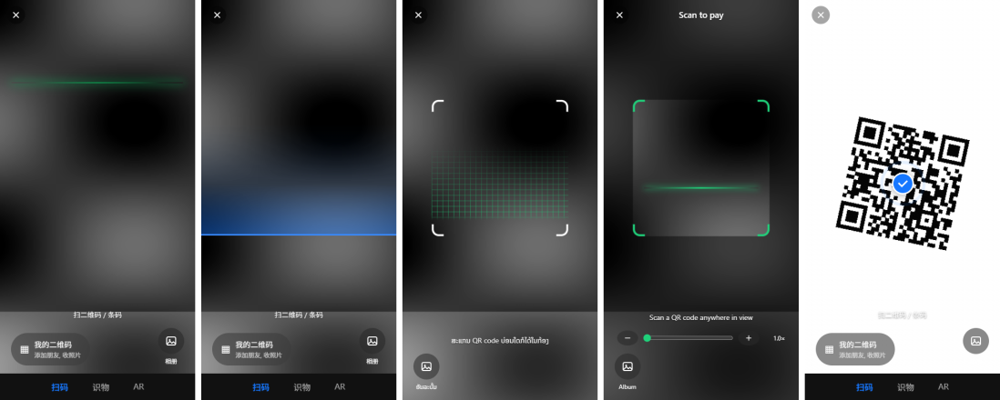

# kqrcode

[](https://www.npmjs.com/package/kqrcode)
[](https://github.com/kris-lx/kqrcode/actions/workflows/ci.yml)
[](LICENSE)

Fast, full-screen QR code scanner for the web, with the scanning experience of WeChat and Alipay: it finds codes anywhere in the camera view, at any angle and from a distance, and zooms in automatically when a code is too small to read.

Works with React, Next.js, Vue, Nuxt, Svelte, SvelteKit, Angular and plain HTML.

> **Status: beta (0.x).** The API may still change before 1.0. Device reports are very welcome; see [Contributing](#contributing).

<p align="center">
  
</p>

## Features

- **Scans the whole camera view**: no need to line the code up with a box. Rotated, skewed and inverted codes all work.
- **Long range**:
  - When it detects a code too small to decode, it zooms in automatically (hardware zoom on Android).
  - On iOS Safari, which has no zoom API, it zooms digitally using a 4K stream.
- **Fast**: [ZXing-C++](https://github.com/zxing-cpp/zxing-cpp) compiled to WebAssembly, running in a Web Worker so the UI never blocks. A 720p frame decodes in about 8 ms on a laptop CPU.
- **Super-resolution for blurry codes**: optionally uses WeChat's super-resolution model, on WebGPU or with a built-in fallback.
- **Small**: about 14 KB gzipped on import. The decoder (~640 KB) downloads only when the scanner opens.
- **Looks how you want**: `wechat`, `alipay`, `grid` and `frame` themes, CSS variables, `::part()` styling and slots for your own buttons and tabs.
- **Complete UX**: pinch and double-tap zoom, tap to focus, flashlight (shown automatically when it is dark), scanning from a photo, sound and haptic feedback.
- **Languages**: English, Lao and Chinese built in; every label can be changed.
- **TypeScript and SSR**: typed APIs; safe to import in Next.js, Nuxt, SvelteKit and Angular SSR.

## Installation

```bash
npx kqrcode init
```

The CLI detects your framework and package manager, installs the package and adds a ready-to-use scanner component. To install manually:

```bash
npm install kqrcode      # or: pnpm add kqrcode · yarn add kqrcode · bun add kqrcode
```

Or with a script tag:

```html
<script src="https://cdn.jsdelivr.net/npm/kqrcode/dist/kqrcode.global.js"></script>
```

## Quick start

**Any framework, one function**

```ts
import { scanQR } from 'kqrcode';

const { text } = await scanQR({ theme: 'wechat' });
```

`scanQR` opens the full-screen scanner, resolves with the first code and cleans up after itself.

**React / Next.js**

```tsx
import { QRScanner } from 'kqrcode/react';

{open && <QRScanner theme="alipay" onScan={(r) => { setOpen(false); pay(r.text); }} onClose={() => setOpen(false)} />}
```

**Vue / Nuxt**

```vue
<script setup>
import { QRScanner } from 'kqrcode/vue';
</script>

<template>
  <QRScanner v-if="open" theme="alipay" @scan="(r) => pay(r.text)" @close="open = false" />
</template>
```

**Svelte / SvelteKit**

```svelte
<script>
  import { qrScanner } from 'kqrcode/svelte';
</script>

<div use:qrScanner={{ theme: 'alipay', onScan: (r) => pay(r.text) }}></div>
```

**Angular / plain HTML**

```html
<kqr-scanner theme="alipay" locale="en"></kqr-scanner>
<script type="module">
  import 'kqrcode';
  document.querySelector('kqr-scanner').addEventListener('scan', (e) => pay(e.detail.text));
</script>
```

Framework-specific notes (Next.js App Router, Nuxt `<ClientOnly>`, Angular `CUSTOM_ELEMENTS_SCHEMA`, CSP) are in **[docs/FRAMEWORKS.md](docs/FRAMEWORKS.md)**.

## Customization

```html
<kqr-scanner theme="alipay" heading="Scan to pay" style="--kqr-accent: #e60012">
  <button slot="actions-left">My QR code</button>
  <nav slot="footer">…</nav>
</kqr-scanner>
```

| | |
|---|---|
| `theme` | `wechat` (default) · `alipay` · `grid` · `frame` · `none` |
| CSS variables | `--kqr-accent`, `--kqr-success`, `--kqr-scan-duration`, `--kqr-frame-size`, `--kqr-button-bg`, … |
| `::part()` | `scanline`, `frame`, `hint`, `torch`, `gallery`, `close`, `success`, … |
| slots | `top-left`, `top-center`, `top-right`, `hint`, `actions-left`, `actions-right`, `footer`, `error` |

See **[docs/CUSTOMIZE.md](docs/CUSTOMIZE.md)** for every option, or build your own UI on the headless `QRScanner` class.

## API

| | |
|---|---|
| `scanQR(options)` | Opens the scanner and resolves with a `ScanResult`. Rejects with a `ScanError` or `AbortError`. |
| `<kqr-scanner>` | Custom element. Events: `scan`, `error`, `close`, `ready`, `zoom`. |
| `QRScanner` | Headless class: `start()`, `stop()`, `setZoom()`, `setTorch()`, `scanImage()`, plus `result`, `hint`, `zoom` and `dark` events. |
| `QRScanner.preload()` | Starts downloading the decoder early, e.g. when the scan button appears. |

Full reference: **[docs/API.md](docs/API.md)**.

```ts
interface ScanResult {
  text: string;             // decoded content
  bytes: Uint8Array;        // raw payload
  corners: { x: number; y: number }[]; // code position in video pixels
  source: 'camera' | 'image';
}
```

## Browser support

| Browser | Notes |
|---|---|
| Chrome / Edge (desktop, Android) | Full support, including hardware auto-zoom on Android |
| Firefox | Full support |
| Safari 15.4+ (iOS, macOS) | Supported. Safari has no camera zoom API, so kqrcode zooms digitally |

Tested in CI and end-to-end on Chrome, Firefox and WebKit. Live-camera results on more devices are being collected, so please report yours in an issue.

The camera requires a **secure context** (HTTPS, or `localhost` during development). If your site sets a Content-Security-Policy, allow `worker-src blob:` and `script-src 'wasm-unsafe-eval'`; `npx kqrcode doctor` checks this for you.

## Performance

On a set of challenging synthetic frames (blur, perspective, low contrast, small codes), kqrcode's decode rate is on par with the open-source WeChat engine (OpenCV `wechat_qrcode`). On frames with no code it does 10–20× less work, which matters for a live camera. Details and how to reproduce: **[docs/BENCHMARK.md](docs/BENCHMARK.md)**.

## FAQ

<details>
<summary><b>The camera does not open.</b></summary>

Check that the page is served over HTTPS and that the user granted camera permission. The `error` event (or the `scanQR` rejection) has a `code`: `permission-denied`, `no-camera`, `camera-busy`, `insecure-context` or `unsupported`.
</details>

<details>
<summary><b>How do I scan continuously, e.g. at a checkout?</b></summary>

Add the `continuous` attribute (or `continuous` prop). Repeats of the same code are ignored for 1.5 s.
</details>

<details>
<summary><b>Can I decode a photo instead of using the camera?</b></summary>

Yes. The album button does this, or call `new QRScanner({ video }).scanImage(file)` yourself.
</details>

<details>
<summary><b>Does it send images anywhere?</b></summary>

No. All decoding happens on the device. The only optional network request is ONNX Runtime Web when you set `superResolution: 'webgpu'`, and you can self-host it.
</details>

## Contributing

Issues and pull requests are welcome. See [CONTRIBUTING.md](CONTRIBUTING.md). When reporting a scanning problem, please include the device, OS and browser version.

## License

[MIT](LICENSE). Third-party components and models: [NOTICE](NOTICE).
